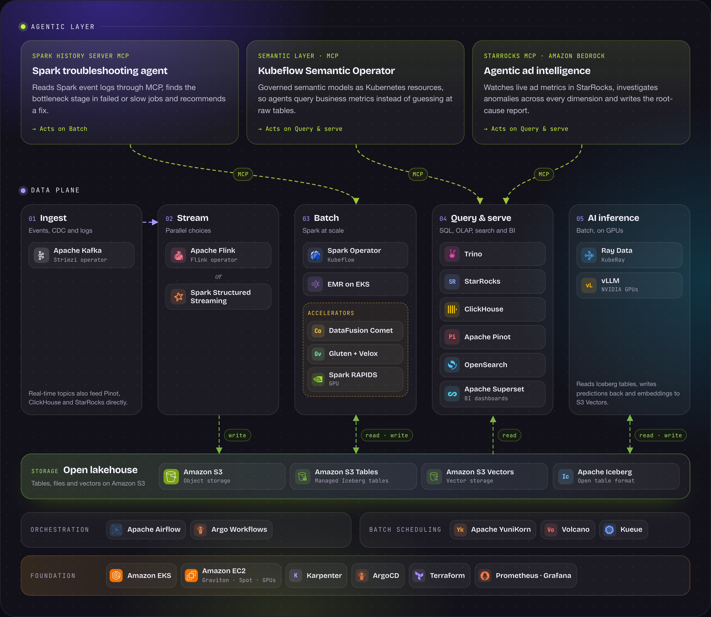

<p align="center">
  <a href="https://awslabs.github.io/data-on-eks/">
    
  </a>
</p>

<h3 align="center">Agentic data platforms on Amazon EKS</h3>

<p align="center">
  Open-source blueprints for streaming, batch, query and AI inference on Kubernetes,<br>
  with the agents, MCP servers and semantic layers that let AI work with your data.
</p>

<p align="center">
  <a href="https://awslabs.github.io/data-on-eks/"><strong>Website</strong></a> ·
  <a href="https://awslabs.github.io/data-on-eks/docs/getting-started">Getting started</a> ·
  <a href="https://awslabs.github.io/data-on-eks/docs/datastacks">Data stacks</a> ·
  <a href="https://awslabs.github.io/data-on-eks/docs/benchmarks">Benchmarks</a> ·
  <a href="https://awslabs.github.io/data-on-eks/docs/ai-ml">Agentic Data</a>
</p>

<p align="center">
  <a href="https://github.com/awslabs/data-on-eks/stargazers"></a>
  <a href="LICENSE"></a>
  <a href="https://aws.amazon.com/eks/"></a>
</p>

---

## Architecture



Every layer is a Terraform + ArgoCD blueprint you can deploy on its own or combine:

| Layer | Projects |
|---|---|
| **Agentic** | Kubeflow Semantic Operator, Spark History Server MCP, StarRocks MCP agents |
| **Ingest & stream** | Apache Kafka (Strimzi), Apache Flink, Spark Structured Streaming |
| **Lakehouse** | Amazon S3, S3 Tables, S3 Vectors and Apache Iceberg, cataloged with AWS Glue Data Catalog, Apache Polaris and DataHub |
| **Batch** | Kubeflow Spark Operator, EMR on EKS, accelerated with DataFusion Comet, Gluten + Velox and Spark RAPIDS on GPUs |
| **Query & serve** | Trino, StarRocks, ClickHouse, Apache Pinot, OpenSearch, Apache Superset, Valkey |
| **AI inference** | Ray Data and vLLM on GPUs |
| **Develop & orchestrate** | JupyterHub, Apache Airflow, Argo Workflows |
| **Batch scheduling** | Apache YuniKorn, Volcano, Kueue |
| **Foundation** | Amazon EKS, Amazon EC2 (Graviton, Spot, GPUs), Karpenter, ArgoCD, Terraform, Prometheus and Grafana |

## Quick start

Each data stack deploys a complete EKS cluster plus its workloads (about 30 minutes):

```bash
git clone https://github.com/awslabs/data-on-eks.git
cd data-on-eks/data-stacks/spark-on-eks
./deploy.sh
```

Then point `kubectl` at the new cluster:

```bash
export KUBECONFIG=kubeconfig.yaml
kubectl get nodes
```

Run `./cleanup.sh` from the same directory to remove everything. Browse all stacks in [`data-stacks/`](data-stacks) or on the [website](https://awslabs.github.io/data-on-eks/docs/datastacks).

## How it works

Data on EKS uses a **base + overlay** layout:

- [`infra/terraform/`](infra/terraform) holds the shared foundation: VPC, EKS, Karpenter, ArgoCD, observability and security.
- [`data-stacks/<name>/`](data-stacks) holds only what a stack changes. At deploy time its files are layered over the base, so every stack stays small and the foundation stays consistent.

See the [contributing guide](https://awslabs.github.io/data-on-eks/docs/datastacks/contributing) to add your own stack.

## Related projects

- [AI on EKS](https://github.com/awslabs/ai-on-eks): blueprints for model training and inference on Amazon EKS.

## Support

Data on EKS is maintained by AWS Solutions Architects and the community. It is not an AWS service, and support is best effort. Please open an [issue](https://github.com/awslabs/data-on-eks/issues) for bugs, questions or ideas.

## Security

See [CONTRIBUTING](CONTRIBUTING.md#security-issue-notifications) for how to report a security issue.

## License

Apache 2.0. See [LICENSE](LICENSE).
