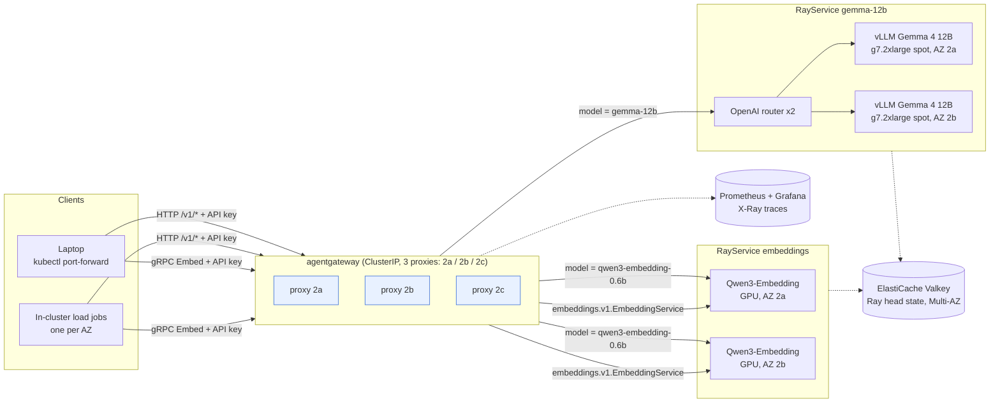

# agentgateway + Ray Serve on EKS: demo guide

A shared inference platform for many internal teams: **one gateway** (agentgateway OSS 1.6) in front of **Ray Serve + vLLM** on GPUs, in one AWS Region across three Availability Zones.

You run everything from a laptop with `kubectl port-forward` and `curl`. Nothing is exposed publicly: there's no load balancer and no Ingress.

---

## What's deployed



| Piece | What it is |
|---|---|
| Gateway | `agentgateway-system/agw-demo-gw`. Listeners: HTTP `:8080` (OpenAI API) and gRPC `:9090`. 3 replicas, one per AZ, PodDisruptionBudget keeps at least 2 up |
| Generation | `gemma-12b`: Gemma 4 12B (QAT int4) on vLLM, 2 GPU replicas in 2 AZs |
| Embeddings | `qwen3-embedding-0.6b`: a custom gRPC `EmbeddingService` (simulates the customer's API) plus OpenAI `/v1/embeddings` |
| Teams | `team-search` and `team-support` (production), `team-labs` (experimental, the "noisy neighbour") |
| Per-team limits (per proxy pod) | search 300 req/min + 300k tokens/min · support 60 + 60k · labs 10 + 3k. Output cap: labs 512, support 2048, search 4096 tokens |
| Prices (internal) | gemma-12b $0.11 in / $1.10 out per 1M tokens · embeddings $0.01 per 1M tokens (from GPU spot $/h ÷ measured tokens/h) |

---

## Lifecycle: build, demo, tear down

| Stage | What to run | Time |
|---|---|---|
| **1. Base infra (Terraform)** | In `data-stacks/ray-on-eks/terraform/data-stack.tfvars` set `enable_agentgateway = true` and `enable_agw_demo = true`, then `cd data-stacks/ray-on-eks && ./deploy.sh` | 10–30 min |
| **2. Demo workloads** | `cd examples/agw-demo && ./setup.sh`: stages the embedding model, deploys both RayServices, the gateway config, the dashboard, then smoke-tests (401 / 200 / 200) | ~10–15 min cold, ~1.5 min if already up (safe to re-run) |
| **3. Demo** | Sections 0–7 below | 45 min |
| **4. Tear down** | `./cleanup.sh` (dry run: lists what it would delete) → `./cleanup.sh --yes` → set both flags to `false` → `./deploy.sh` | ~5 min + deploy.sh |

Re-demoing after a teardown is stages 1 → 2 → 3. Cost while up: about $5.3/hour (4 × g7.2xlarge spot, 3 small on-demand CPU nodes, 2 × cache.t4g.small).

> Teardown order matters: `cleanup.sh` removes the RayServices and Gateway objects **before** Terraform removes the NodePools, namespace and gateway controller, so nothing is orphaned. It never touches pre-existing components or the Gemma 4 weights in S3.

---

## 0. Set up your laptop (2 minutes)

**Terminal 1: port-forwards** (leave it running):

```bash
cd ~/Documents/github/data-on-eks/data-stacks/ray-on-eks/examples/agw-demo
./demo/port-forward.sh
```

You'll see `gateway http: http://localhost:8080   gateway grpc: localhost:9090   grafana: http://localhost:3000`.

**Terminal 2: load the team API keys** (the script never prints them):

```bash
cd ~/Documents/github/data-on-eks/data-stacks/ray-on-eks/examples/agw-demo
source demo/team-keys.sh
```

You'll see `loaded SEARCH_KEY SUPPORT_KEY LABS_KEY (lengths: 43 44 41)`.

> If `kubectl` points at another cluster, run this first:
> `export KUBECONFIG=~/Documents/github/data-on-eks/data-stacks/ray-on-eks/kubeconfig.yaml`
>
> A port-forward always talks to **one** gateway pod, so the per-pod limits above apply exactly as configured.

---

## 1. One gateway, two APIs: OpenAI generation + custom gRPC embeddings

**What it shows:** the customer's two API styles go through the same endpoint, with the same team key. The `model` field picks the backend.

**List the models:**

```bash
curl -s localhost:8080/v1/models -H "Authorization: Bearer $SEARCH_KEY" | jq '[.data[].id]'
```

Expect `["gemma-12b", "qwen3-embedding-0.6b"]`. The gateway builds this list itself from the models attached to it.

**Chat (OpenAI-compatible):**

```bash
curl -s localhost:8080/v1/chat/completions -H "Authorization: Bearer $SEARCH_KEY" -H "Content-Type: application/json" \
  -d '{"model":"gemma-12b","messages":[{"role":"user","content":"What is Amazon EKS? One sentence."}],"max_tokens":60}' | jq '{answer: .choices[0].message.content, usage}'
```

Expect a one-sentence answer plus `usage` (prompt and completion tokens), in under a second.

**Streaming:**

```bash
curl -sN localhost:8080/v1/chat/completions -H "Authorization: Bearer $SEARCH_KEY" -H "Content-Type: application/json" \
  -d '{"model":"gemma-12b","stream":true,"messages":[{"role":"user","content":"Count to 5"}],"max_tokens":30}'
```

Expect tokens arriving as `data:` lines, then a final chunk with `"usage":{...}`, then `data: [DONE]`. The client didn't ask for usage: the gateway injects `stream_options.include_usage` so streamed requests are still metered.

**Embeddings over HTTP:**

```bash
curl -s localhost:8080/v1/embeddings -H "Authorization: Bearer $SUPPORT_KEY" -H "Content-Type: application/json" \
  -d '{"model":"qwen3-embedding-0.6b","input":["hello","world"]}' | jq '{n: (.data|length), dim: (.data[0].embedding|length), usage}'
```

Expect `{"n": 2, "dim": 1024, "usage": {...}}`.

**Custom gRPC embeddings.** Install grpcurl once (`brew install grpcurl`), then:

```bash
grpcurl -plaintext -v -import-path proto -proto embeddings.proto \
  -H "authorization: Bearer $SEARCH_KEY" \
  -d '{"model":"qwen3-embedding-0.6b","texts":["hello from my mac"]}' \
  localhost:9090 embeddings.v1.EmbeddingService/Embed
```

Expect:
- a 1024-number vector and `"promptTokens"`
- the gateway's rate-limit headers (`x-ratelimit-limit: 600`)
- the trailer `x-usage-prompt-tokens: 5`

The gateway routes this with a standard Kubernetes `GRPCRoute`, matched on the gRPC service name.

---

## 2. Authentication and shared endpoints

**What it shows:** every team uses the same URL. The API key identifies the team, and nothing gets through without a valid key.

```bash
# No key
curl -s -w ' -> %{http_code}\n' localhost:8080/v1/models
# Wrong key
curl -s -w ' -> %{http_code}\n' localhost:8080/v1/models -H "Authorization: Bearer agw-not-a-real-key"
# Unknown model
curl -s localhost:8080/v1/chat/completions -H "Authorization: Bearer $SEARCH_KEY" -H "Content-Type: application/json" \
  -d '{"model":"gpt-4o","messages":[{"role":"user","content":"hi"}]}'
```

Expect:
- No key: `api key authentication failure: no API Key found -> 401`
- Wrong key: `... invalid credentials -> 401`
- Unknown model: an OpenAI-style `404 model_not_found`
- gRPC without a key returns `Code: Unauthenticated`

How it works:
- The gateway stores only **SHA-256 hashes** of the keys, with team metadata (`team`, `tier`).
- The gateway forwards a trusted `x-team-id` header to the backends.
- It strips the client's API key, so Ray never sees it.

---

## 3. Rate limiting and overload protection

**What it shows:** a noisy team gets throttled with standard `429` + `Retry-After`, and the other teams don't notice.

**Noisy neighbour:**

```bash
for i in {1..12}; do curl -s -o /dev/null -w "labs $i: %{http_code}\n" localhost:8080/v1/chat/completions \
  -H "Authorization: Bearer $LABS_KEY" -H "Content-Type: application/json" \
  -d '{"model":"gemma-12b","messages":[{"role":"user","content":"Describe Kubernetes in detail."}],"max_tokens":300}'; done

curl -s -o /dev/null -w "search: %{http_code} in %{time_total}s\n" localhost:8080/v1/chat/completions \
  -H "Authorization: Bearer $SEARCH_KEY" -H "Content-Type: application/json" \
  -d '{"model":"gemma-12b","messages":[{"role":"user","content":"hi"}],"max_tokens":10}'
```

Expect:
- `team-labs` gets `200` for about 6 requests, then `429` once its 3,000 tokens/minute budget runs out. Add `-D -` to see `x-ratelimit-limit: 3000`, `x-ratelimit-remaining: 0` and `Retry-After`.
- `team-search` still gets `200` in well under a second.

Limits are per team, for both **requests** and **tokens**, and tokens count input + output.

**Per-request protection (max_tokens cap):**

```bash
curl -s localhost:8080/v1/chat/completions -H "Authorization: Bearer $LABS_KEY" -H "Content-Type: application/json" \
  -d '{"model":"gemma-12b","max_tokens":8000,"messages":[{"role":"user","content":"Write a 3000 word essay on GPUs."}]}' \
  | jq '{completion_tokens: .usage.completion_tokens, finish: .choices[0].finish_reason}'
```

Expect `{"completion_tokens": 512, "finish": "length"}`. The experimental team can't book a GPU for minutes with one huge request. Smaller requests are honoured as sent.

**GPU saturation (bounded queues).** Ray Serve accepts at most 64 in-flight requests per Gemma replica, plus 16 queued. Beyond that it answers `503` immediately instead of letting latency grow without bound. Run the overload profile from inside the cluster, then watch the dashboard's *Backend overload* panel:

```bash
./demo/loadgen/run.sh overload 60 us-west-2a
kubectl -n agw-demo logs -l app=agw-demo-loadgen --tail=-1 | sed -n '/SUMMARY/,$p'
```

Measured: `team-search` sent about 39 requests/s for 60 s, roughly 2× what the two GPUs can serve.

| Outcome | Count | Meaning |
|---|---|---|
| `200` | 1,329 | served. Latency p50 2.7 s / p95 6.4 s / p99 7.8 s (1.8 s unloaded): bounded, no timeouts |
| `429` | 883 | **gateway** per-team request limit (layer 1) |
| `503` | 116 | **Ray Serve** queue full, rejected immediately (layer 2) |
| timeouts / 5xx from crashes | 0 | Gemma answered in 0.3 s right after the test |

---

## 4. Usage metering and team chargeback

**What it shows:** every request is attributed to a team with tokens and a dollar cost, with no custom gateway code.

**Generate a realistic multi-team workload** from inside the cluster (one Job per AZ, 5 minutes):

```bash
./demo/loadgen/run.sh mixed 300
```

**See it per request in the gateway's access log:**

```bash
kubectl -n agentgateway-system logs -l gateway.networking.k8s.io/gateway-name=agw-demo-gw --tail=200 \
  | grep '"scope":"request"' | grep -v '"listener":"grpc"' | tail -5 \
  | jq -c '{team, model: ."gen_ai.request.model", status: ."http.status", in: ."gen_ai.usage.input_tokens", out: ."gen_ai.usage.output_tokens", usd: ."agw.ai.usage.cost.total", ttft_s: ."agw.ai.time_to_first_token", ms: .duration}'
```

Expect one line per request with team, model, tokens, USD cost and latency. For example:
`{"team":"team-labs","model":"gemma-12b","status":200,"in":33,"out":512,"usd":"0.00056683",...}`
The math: 33 × $0.11/1M + 512 × $1.10/1M = $0.00056683.

**See it per team in Grafana** at http://localhost:3000 (dashboard **agw-demo · Tenant chargeback & SLOs**; section 6 below explains it).

### Does chargeback need another add-on?

**No.** It uses only what's already there:

| Data | Comes from | Extra component? |
|---|---|---|
| Tokens per team and model | agentgateway metric `agentgateway_gen_ai_client_token_usage` + the `team` label (one policy line: `apiKey.team`) | No |
| **Dollar cost per team** | agentgateway metric `agentgateway_gen_ai_client_cost_usd_total`, priced by the gateway's **model cost catalog** (a ConfigMap with our internal rates) | No |
| Per-request audit record | gateway JSON access log (team, tokens, cost, latency, trace id) | No |
| Dashboards | the cluster's existing Prometheus + Grafana | No |
| gRPC embedding tokens | the embeddings service's own counter `embed_tokens_total{team}`, team taken from the gateway-injected `x-team-id` | No new component, about 15 lines in the service |

**Why gRPC is counted by the service:** for HTTP, the gateway reads the OpenAI `usage` field itself. A custom gRPC API has no standard usage field. The service returns the count in a gRPC *trailer*, and agentgateway 1.6 can't read trailers in its logs yet. So the service counts tokens, keyed by the team the gateway vouches for. For HTTP embeddings the gateway meters directly.

**For production invoicing** (out of scope for the demo): ship the JSON access logs to S3 (Fluent Bit → Firehose → S3) and query them with Athena. Logs are the durable, per-request source of truth. Prometheus is for dashboards and alerts. Teams can export the chargeback table as CSV from Grafana (panel menu → Inspect → Data).

---

## 5. Latency and availability

**What it shows:** low, predictable latency, and no single point of failure inside the Region.

**Measured** (mixed load: 3 teams, about 2.3 chat req/s + 6 gRPC req/s, in-cluster):

| Metric | Value |
|---|---|
| Time to first token (streaming), p50 / p95 / p99 | **50 ms / 60 ms / 80 ms** |
| Time per output token, p50 / p95 | 17.5 ms / 24 ms |
| Chat, 120 output tokens, end-to-end p50 / p95 | 1.81 s / 1.85 s, the same for every team |
| gRPC embeddings (3 texts) through gateway, p50 / p95 | **29 ms / 35 ms** |
| HTTP embeddings through gateway, p50 / p95 | 34 ms / 45 ms |
| Errors (5xx / timeouts) during the run | **0** |

**Availability: check the layout:**

```bash
# One gateway proxy per AZ
kubectl -n agentgateway-system get pods -l gateway.networking.k8s.io/gateway-name=agw-demo-gw -o wide
# GPU workers split across 2a and 2b
kubectl get nodes -l 'agw-demo/pool in (gpu-gemma,gpu-embed)' -L topology.kubernetes.io/zone,node.kubernetes.io/instance-type
```

Expect 3 proxies on nodes in 2a, 2b and 2c, and 4 GPU nodes (2 per model) in 2a and 2b.

Design choices:
- Every hop has at least two replicas in different AZs: the gateway, the OpenAI router, and the model replicas.
- Ray head state lives in **ElastiCache Valkey (Multi-AZ)**, so a lost head pod comes back without losing the Serve apps.
- The Ray Serve Services use `trafficDistribution: PreferClose`, so traffic prefers the same AZ.

**Gateway overhead** (same request direct to Ray vs through the gateway, interleaved, from one in-cluster pod):

| Path | Direct p50 / p99 | Via gateway p50 / p99 | Overhead p50 / p99 |
|---|---|---|---|
| Chat (`max_tokens: 1`) | 27.4 / 28.9 ms | 29.6 / 32.8 ms | **+2.3 / +3.9 ms** |
| gRPC Embed | 24.3 / 25.3 ms | 25.6 / 26.6 ms | **+1.3 / +1.3 ms** |

The chat path does auth, body parsing, model routing, two rate-limit buckets, cost pricing, JSON logging and 100% trace sampling.

```bash
./demo/loadgen/run.sh steady 1 us-west-2a   # creates the code ConfigMap
kubectl apply -f demo/loadgen/overhead-job.yaml && kubectl -n agw-demo wait --for=condition=complete job/agw-demo-overhead --timeout=600s
kubectl -n agw-demo logs job/agw-demo-overhead | grep RESULT
```

**Availability drills.** Start steady background traffic from all three AZs, run a drill, then count what the clients saw:

```bash
./demo/loadgen/run.sh steady 1200 us-west-2a,us-west-2b,us-west-2c --timeline 5
./demo/drills.sh gateway      # (a) kill one gateway proxy
./demo/drills.sh gpu-node     # (b) lose the Gemma GPU node in us-west-2a (spot reclaim / AZ loss)
./demo/drills.sh ray-head     # (c) kill the Gemma Ray head
./demo/drills.sh errors 300   # failed requests seen by clients in the last 5 minutes
```

| Drill | What happened | Client impact (measured) |
|---|---|---|
| (a) Delete a gateway proxy pod | Replacement Ready in ~8 s. The PDB blocked further voluntary evictions meanwhile | **0 failed of 438** requests |
| (b) Lose the Gemma GPU node in 2a | The 2b replica carried all chat. Karpenter launched a new 2a spot node immediately; back to 2 replicas in **6m22s** | **4 failed of 1,232 chats (0.3%)**, all in one 5-second window (the evicted replica's in-flight requests). 0 of 7,842 embedding requests failed |
| (c) Delete the Gemma Ray head | New head in ~36 s, loaded Ray state from Valkey, re-adopted the **running** replicas (no GPU worker restarted). Fully reconciled in **78 s** | **0 failed of 1,207** requests |

**Multi-Region:** each Region is a self-contained copy of this stack, and the manifests differ only in Region values (bucket, Valkey endpoint, AZs, registry). Tenants use a Region-local DNS name, with no cross-Region failover by design, and every Region's access logs land in one central S3 bucket for chargeback. *Not deployed in this demo* (see the status table).

---

## 6. Logging and telemetry out of the box

**What it shows:** logs, metrics and traces with no code in the gateway.

| Signal | Where | What's in it |
|---|---|---|
| Access logs | `kubectl logs` on the gateway (JSON) | team, tier, model, tokens in/out, USD cost, time to first token, time per token, upstream, status, duration, trace id |
| Metrics | Prometheus (`agentgateway_*`), scraped automatically | requests by team/status, tokens, cost, TTFT/TPOT histograms, request duration, cost-catalog lookups |
| Traces | AWS X-Ray (via the cluster's ADOT collector) | one trace per request: gateway span → backend span |
| Backend | Prometheus (`ray_serve_*`, `ray_vllm_*`, `ray_embed_*`) | queue depth, replica health, KV-cache usage, per-team embedding tokens |

**Open a trace:** copy a `trace.id` from an access-log line, then open it in the X-Ray console as `1-<first 8 chars>-<remaining 24 chars>`.

### The dashboard: agw-demo · Tenant chargeback & SLOs

Open http://localhost:3000 → Dashboards → **agw-demo · Tenant chargeback & SLOs**.

The **Team (tenant)** dropdown at the top controls everything:
- **All**: the platform team's view of every tenant.
- **One team**: what you'd share with that tenant. Every panel filters to that team.

The time picker sets the billing window (for example "Last 30 days").

| Section | Panels | Customer requirement |
|---|---|---|
| 1 · Usage metering & chargeback | Total cost, requests, tokens, gRPC tokens · **Chargeback by team table** (requests, input/output tokens, gRPC tokens, LLM cost, gRPC cost, total, 429s, 5xx) · cost share donut · spend rate ($/h) · tokens/s by team | Metering and chargeback |
| 2 · Rate limiting & overload | Requests/s by team and status · 429s by team · backend 503s + Ray queue depth | Rate limiting and overload protection |
| 3 · Latency & availability | TTFT p50/p95/p99 · time per output token · gateway latency p50/p99 (HTTP vs gRPC) · proxies up · success ratio · healthy Ray replicas · vLLM KV-cache usage | Latency and availability |
| 4 · Telemetry health | Cost-catalog lookups (Exact = priced) · traffic by listener and route | Logging and telemetry |

> Grafana login: the user is in `admin-user` and the password in `admin-password` of Secret `monitoring/grafana-admin-secret`:
> `kubectl -n monitoring get secret grafana-admin-secret -o jsonpath='{.data.admin-password}' | base64 -d`
> The dashboard JSON lives in `demo/dashboards/`; `observability/build_dashboard.py` regenerates it.

---

## 7. Minimal components

**What it shows:** the gateway adds two Deployments and no databases.

```bash
kubectl -n agentgateway-system get deploy,pods
kubectl get svc -A | grep -i loadbalancer   # only the cluster's pre-existing ingress-nginx
```

Expect `agentgateway` (control plane, 2 pods) and `agw-demo-gw` (proxies, 3 pods). There's no Redis, Postgres or sidecar for the gateway. Valkey exists only to keep Ray head state.

| | Gateway processes to run | State stores |
|---|---|---|
| **agentgateway (this demo)** | control plane + proxies | none |
| LiteLLM proxy (typical production setup) | proxy | Postgres (keys, spend) + Redis (limits, cache) |
| Envoy Gateway + an AI router | Envoy Gateway controller, Envoy proxies, AI ext-proc service, rate-limit service | Redis |

Optional: if a team needs **one shared budget across all proxy pods** instead of per-pod limits, agentgateway OSS supports global limits with one extra rate-limit service + Redis.

---

## Customer requirements: status

| # | Requirement | Status | Evidence in this demo |
|---|---|---|---|
| 1 | Rate limiting and overload protection for shared endpoints | 🟢 | Per-team request + token limits: labs throttled with 429 + Retry-After while search stayed 200. max_tokens cap: 8000 → 512. 2× GPU saturation: gateway 429s + Ray's fast 503s, served requests stayed bounded (p99 7.8 s), 0 timeouts, instant recovery. The first overload run exposed a router failure, fixed by running 2 router replicas with Ray's default router |
| 2 | Usage metering and team chargeback across teams | 🟢 | Tokens and USD per team from native gateway metrics + cost catalog. Per-request JSON audit log. Grafana chargeback table with team dropdown. gRPC tokens counted by the service via a gateway-trusted team header |
| 3 | Strong latency and availability for multi-Region inference | 🟢 latency · 🟢 availability (multi-AZ) · ⚪ multi-Region | 🟢 TTFT p50 50 ms; gateway overhead +2.3 ms (chat) / +1.3 ms (gRPC) at p50; 0 errors under mixed load. 🟢 Drills: proxy kill 0 errors; GPU node/AZ loss 0.3% of chats in one 5 s window, recovered in 6m22s; Ray head kill 0 errors, 78 s reconcile. ⚪ Second Region not deployed: design only (each Region is a self-contained copy of these manifests) |
| 4 | Logging and telemetry out of the box | 🟢 | JSON access logs with team/tokens/cost/TTFT. Prometheus metrics with a team label, scraped automatically. Traces in X-Ray. No gateway code |
| 5 | Custom gRPC embeddings and OpenAI-compatible generation | 🟢 | gRPC `EmbeddingService/Embed` via `GRPCRoute`. OpenAI chat (streaming + non-streaming), embeddings and models through the same gateway, same keys |
| 6 | Minimal additional components | 🟢 | 2 Deployments (control plane + proxies), no database or cache for the gateway, ClusterIP only |

🟢 tested and passing · 🟡 partly tested, remaining step listed · ⚪ not tested in this environment

---

## Known limitations (said plainly)

- **Local rate limits are per proxy pod.** With 3 proxies a team's cluster-wide quota is about 3× the per-pod value. For an exact shared budget, add agentgateway's global rate limiting (OSS, needs a rate-limit service + Redis).
- **Spend budgets and a cost UI** are Solo Enterprise features. In OSS, cost is a metric + log field (as shown) and the dashboard is Grafana.
- **Tenant priority under GPU overload** (production before experimental) isn't in this demo. It needs llm-d flow control (InferencePool + endpoint picker), which agentgateway supports as a next step.
- **gRPC token metering** needs the service to report tokens (it does here, via a team-keyed counter), because the gateway can't read gRPC trailers yet.
- **Losing a GPU node drops that replica's in-flight requests** (4 of 1,232 in the drill). Graceful drain is a next step: a longer termination grace period plus a preStop that drains Ray Serve.
- **GPU NodePool limits must leave room for a replacement node (N+1).** At exactly 2 GPUs, a drained node blocked its own replacement ("exceed limits for nodepool"). The code now says 3. It applies on the next `deploy.sh`.
- **Prefix-aware routing was turned off.** Ray's `PrefixCacheAffinityRouter` grew to 12+ GiB and stopped forwarding under overload in this Ray version (2.57). The demo uses Ray's default router with 2 router replicas.

---

## Troubleshooting

| Symptom | Fix |
|---|---|
| `curl: (7) Failed to connect to localhost port 8080` | Terminal 1's port-forward stopped. Re-run `./demo/port-forward.sh` |
| `401 invalid credentials` | Re-run `source demo/team-keys.sh` in this terminal (keys are per shell) |
| `429` for your own tests | You hit the team's per-minute limit. Wait for `Retry-After` seconds or use `$SEARCH_KEY` |
| Chat hangs | `kubectl -n agw-demo get rayservice`. Both should be `Running` with 2 endpoints |
| Empty Grafana panels | Run some traffic (`./demo/loadgen/run.sh mixed 120`) and set the time range to "Last 15 minutes" |

## Files

| Path | What |
|---|---|
| `setup.sh`, `cleanup.sh` | build / tear down the demo workloads (Terraform side is `deploy.sh`) |
| `demo/port-forward.sh`, `demo/team-keys.sh` | laptop setup |
| `demo/drills.sh`, `demo/loadgen/overhead.py` | availability drills, gateway overhead A/B |
| `demo/loadgen/` | in-cluster multi-team load generator (`run.sh <mixed\|noisy\|overload\|custom> <seconds>`) |
| `demo/dashboards/agw-demo-tenant-chargeback.json` | Grafana dashboard (generated by `observability/build_dashboard.py`) |
| `gateway/` | Gateway, parameters, models, gRPC route, team keys, policies, cost catalog (`gateway/deploy.sh`) |
| `ray/` | RayServices and the custom embeddings app |
| `proto/` | `embeddings.proto` + generated Python stubs |
| `NOTES.md` | every decision, version check and surprise, with timestamps |
